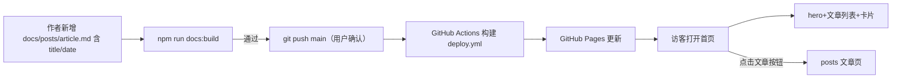
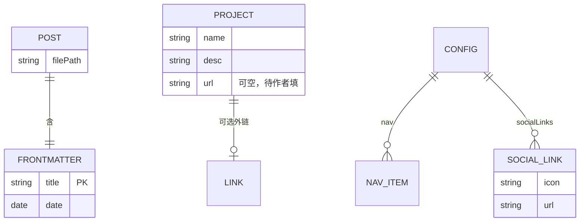

# VitePress 个人博客「首页改版」需求规格说明书（PRD）

> | 文档名称 | 需求规格说明书（PRD） |
> |----------|----------------------|
> | 版本 | v0.2 |
> | 作者角色 | 产品经理 |
> | 日期 | 2026-10-16 |
> | 状态 | 评审稿 |

---

## 1. 产品目标与价值

- **背景与要解决的问题**：当前仓库 `docs/` 仅剩导航框架（index.md 为空壳 hero、about.md 无正文），首页缺少博客核心能力——没有文章入口、没有项目展示，访客无法感知站点内容。
- **建设目标**：将首页建设为「Hero 落地页 + 内容聚合」形态：hero 区（头像/姓名徽标、姓名、打字机 tagline、快捷按钮）+ 最新文章列表 + 技能简介 + 项目作品卡片 + 社交链接，沿用现有蓝灰浅色系。
- **成功标准（可量化）**：
  - 指标 1：首页构建后包含全部 4 个内容模块（文章列表、技能简介、项目卡片、社交链接），模块覆盖率 100%。
  - 指标 2：`npm run docs:build` 成功，耗时 ≤ 60s，产出 HTML 中渲染全部模块元素。
  - 指标 3：新增一篇含 `title`/`date` frontmatter 的文章后，重建即自动出现在列表（前 5 条），无需修改首页代码。
  - 指标 4：375px 宽视口无横向滚动；reduced-motion 下无打字动画。

## 2. 用户角色与权限矩阵

| 角色 | 职责描述 | 核心权限 |
|------|---------|---------|
| 访客 | 浏览首页、点击文章与链接 | 查看首页全部模块、跳转文章详情与外链 |
| 作者（站主/蒋璐新） | 维护内容与配置 | 新增/编辑 md 文章与 frontmatter、编辑 ProjectCards.vue 中的项目数组（含填 Gitee 链接）、修改 config.mjs 导航与 socialLinks、修改主题样式、放置头像图 |

## 3. 用户故事

- US-01：作为访客，我希望打开首页先看到醒目的标题、头像/名字徽标与一句话 tagline，以便 3 秒内了解这个博客是谁的、写什么。（FR-01）
- US-02：作为访客，我希望在首页看到按时间倒序的最新文章标题与日期，并可点击进入阅读，以便快速获取新内容。（FR-02）
- US-03：作为访客，我希望在首页看到技能标签组，以便了解作者的技术方向。（FR-03）
- US-04：作为访客，我希望看到项目/作品卡片（名称+技术栈/一句话描述+链接），以便了解作者的实际产出。（FR-04）
- US-05：作为访客，我希望通过导航栏或 hero 区快速跳转作者 GitHub，以便查看代码。（FR-05）
- US-06：作为访客，我希望在手机上浏览首页不错位、无横向滚动，以便随时阅读。（FR-06）
- US-07：作为访客，我希望系统为深色模式时首页自动切换深色且清晰可读，以便夜间阅读舒适。（FR-06）
- US-08：作为访客，我希望开启「减少动态效果」时打字机不播放而完整显示全文，以便不因动效丢失信息。（FR-01）
- US-09：作为作者，我希望发布 `docs/posts/` 新文章（含 title/date）后首页列表自动收录，以便零成本更新首页。（FR-02）
- US-10：作为作者，我希望项目卡片的名称、描述和链接都能由我直接编辑 Theme 组件数组填入（含 Gitee 地址），以便自行维护项目信息。（FR-04）

## 4. 功能需求清单（需求池）

| 编号 | 模块 | 功能 | 优先级 | 说明 |
|------|------|------|--------|------|
| FR-01 | Hero 区 | 名字徽标或头像图 + 姓名 + 打字机 tagline + 快捷跳转按钮 | P0 | 头像接口式：检测 `docs/public/avatar.jpg` 存在（建议 400×400）则显示图片，否则回退为显示名字的圆形徽标；按钮为跳转链接，后续可扩展 |
| FR-02 | 文章列表 | 自动聚合文章并列出 | P0 | 数据源改为 `docs/posts/**/*.md`；frontmatter 必填 `title`、`date`（YYYY-MM-DD）；按 date 倒序取前 5 条；显示标题链接与日期；无文章时显示占位文案 |
| FR-03 | 技能简介 | 技能标签组 | P1 | 默认标签：Python、LangGraph、LLaMA-Factory、vLLM、FastAPI、RAG；横向换行排列 |
| FR-04 | 项目卡片 | 2-3 个项目卡片 | P1 | 卡片含名称、技术栈一句话描述、项目地址；链接由作者在 `ProjectCards.vue` 数组中自行填入（如 Gitee），未填时显示「链接待填写」占位 |
| FR-05 | 社交链接 | GitHub 图标链接 | P0 | 沿用 config.mjs `socialLinks`（github.com/Jrwisefools），hero 区再加显式入口 |
| FR-06 | 响应式与暗色 | 移动端适配；跟随系统深色 | P0 | 内容最大宽度 720px；375px 宽无横向滚动；`prefers-color-scheme: dark` 分支对比度 ≥ 4.5:1 |
| FR-07 | 部署链路 | push 自动发布 | P0 | 依赖现有 `.github/workflows/deploy.yml`，不改部署配置 |

- P0 覆盖主流程：访客打开首页 → 看到 hero 与内容 → 点进文章。

## 5. 非功能需求（量化）

| 类别 | 要求 | 指标 |
|------|------|------|
| 性能 | 首页加载与构建 | 依赖包体积 ≤ 600；构建耗时 ≤ 60s；不引入远程 CDN/字体 |
| 兼容性 | 浏览器/终端 | Chrome/Edge/Firefox/Safari 近两个大版本；375px-1440px 无横向滚动；深浅两模式可渲染 |
| 可访问性 | 降级与对比度 | 正文对比度 ≥ 4.5:1；reduced-motion 下停用打字动画；动效完成或降级后全文可读 |
| 可观测性 | 本地验证 | `docs:build` 成功且构建产物中渲染各模块标记 |

## 6. 核心业务流程图



## 7. 关键页面原型说明

**首页（docs/index.md，layout: page，挂载 HeroHome 组件）**

```
┌──────────────────────────────────────────┐
│ NAV: 首页 | 关于            [GitHub icon] │ ← 现有导航
├──────────────────────────────────────────┤
│          [头像图或名字圆形徽标 96px]        │ ← 头像接口(检测avatar.jpg)
│                 蒋璐新                     │ ← h1
│       打字机 tagline（RAG/后端方向…）        │ ← FR-01
│        [看文章]  [关于我]                   │ ← 跳转按钮
│        <GitHub 显式入口>                   │ ← FR-05
├──────────────────────────────────────────┤
│ 关于我：一句话介绍                          │ ← 技能简介
│ [Python][LangGraph][LLaMA-Factory]…       │
├──────────────────────────────────────────┤
│ 最新文章                                   │
│  · 文章标题        日期                    │ ← ≤5条，date倒序
│  · ……                                     │
├──────────────────────────────────────────┤
│ 项目作品                                   │
│  ┌──────────┐ ┌──────────┐ ┌──────────┐  │ ← 2-3卡片，链接留待作者填
│  │RAG 知识库 │ │FastAPI…  │ │ …        │  │
│  └──────────┘ └──────────┘ └──────────┘  │
└──────────────────────────────────────────┘
```

**文章页（docs/posts/*.md）**：默认主题排版，仅全局样式生效（隐藏侧边栏、窄内容区）。

## 8. 数据实体初稿（ER）



- **POST**：`docs/posts/*.md`，frontmatter 必填 `title`、`date`（YYYY-MM-DD）。
- **PROJECT**：数组硬编码于 `ProjectCards.vue`，`url` 可为空，显示「链接待填写」，作者自行填 Gitee 等地址。
- **CONFIG**：`config.mjs` 的 nav 与 socialLinks。

## 9. 验收标准（AC）

| 功能（FR） | 验收条件（前置—操作—预期） |
|-----------|--------------------------|
| FR-01 | 给定首页已构建，当打开首页，则 hero 区显示名字徽标/头像、姓名、tagline 与可点击按钮 |
| FR-02 | 给定 `docs/posts/` 有 ≥6 篇含 title/date 文章，当打开首页，则显示最新 5 篇、date 倒序、可点击进入文章页 |
| FR-02(空态) | 给定 `docs/posts/` 为空，当打开首页，则显示占位文案不报错 |
| FR-03/04 | 给定首页已构建，当浏览简介与项目区，则标签组与 2-3 个项目卡正常渲染，已填链接可跳转、未填显示占位 |
| FR-05 | 当点击导航 GitHub 图标或 hero 区 GitHub 入口，则打开 github.com/Jrwisefools |
| FR-06 | 给定 375px 视口，当打开首页，则无横向滚动、模块单列；深色系统下自动切换且对比度 ≥ 4.5:1 |
| FR-08(degrade) | 给定系统开启减少动态效果，当打开首页，则 tagline 不播打字动画而完整显示 |

## 10. 依赖与约束

- **外部依赖**：VitePress 1.6.4；GitHub Actions+Pages+CNAME 部署链路（不改 CI 配置）；GitHub 外链 github.com/Jrwisefools。
- **约束**：纯静态构建，不引入额外框架或远程 CDN/字体；项目链接由作者自行填入；不自行 push，发布需用户确认；遵循既有 Git 规范。

## 11. 待确认问题（Open Questions）

| 编号 | 问题 | 建议确认方 |
|------|------|-----------|
| Q1 | 项目卡片数组中 url 字段是否需要同时预留 Gitee 与 GitHub 双链接 | 作者 |
| Q2 | 首页 tagline 具体文案用语 | 作者 |
| Q3 | 「看文章」按钮跳转目标锚点名称 | 作者 |
